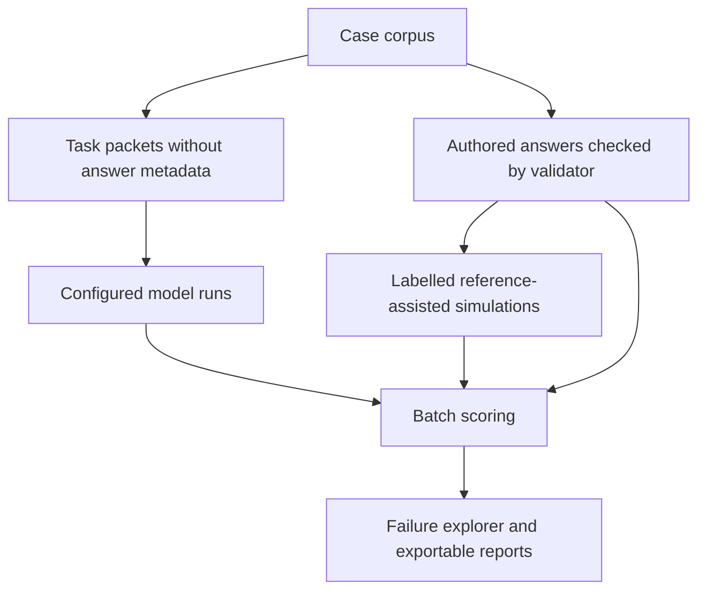

# RefMatch

**Explain referee assignments. Evaluate the reasoning behind them.**

RefMatch combines a football appointment-planning prototype with an AI Evaluation Lab. The planner helps a committee build a matchweek allocation using historical evidence and explicit constraints. The Evaluation Lab tests whether a system can read committee updates, apply appointment rules, identify unsafe plans, and recognize missing information.

**Project owner:** [Mohammed Roqa](https://mroqa.site/).

| Explore | Link |
| --- | --- |
| Evaluation Lab 2.0 | [Open the Evaluation Lab](https://mohammedroqa.github.io/Refmatch/demo/eval.html) |
| Matchweek planner | [Open the committee workspace](https://mohammedroqa.github.io/Refmatch/demo/) |
| Project website | [RefMatch](https://mohammedroqa.github.io/Refmatch/) |
| Technical evaluation guide | [Method, metrics, review and provider setup](docs/evaluation-v2.md) |
| Verification evidence | [Evaluation Lab 2.0 verification report](docs/verification-evals-v2.md) |

The published GitHub Pages site supports manual planning, labelled simulations, report imports, and browser-local review records. Live model calls and source-data refreshes require the separately configured local server or CLI.

## micro1 Eval Hackathon

**Event:** [micro1 Eval Hackathon on HackerRank](https://www.hackerrank.com/event/micro1-eval-hackathon).

This README presents RefMatch Evaluation Lab as Mohammed Roqa's evaluation project for review in the context of the micro1 Eval Hackathon. Its central question is: **Can an AI reliably detect unsafe referee allocations, interpret changing committee evidence, and recognize when information is insufficient?**

The football appointment scenario makes evaluation concrete: a confident explanation can accompany an invalid plan, a late update can change availability, and missing evidence should prevent clearance. RefMatch makes these failures inspectable through explicit rules, authored references, reproducible batches, and separate evidence-reading and rule-audit tasks.

Reviewers can examine the source, run the public demonstration, inspect exported reports, and reproduce the documented checks. Use the linked event page for official rules and submission instructions; the table below summarizes evidence available in this repository.

| Area to review | Evidence in this project |
| --- | --- |
| Task and reference design | Separate evidence-reading and rule-audit tasks; authored labels checked against a deterministic validator. |
| Dataset quality | 136 synthetic cases across 24 families; development and public-validation families remain separate; related variants stay together. |
| Evaluation rigor | Unsafe-clearance metrics, explicit denominators, failed-attempt accounting, separate trials, extraction and citation scoring. |
| Reproducibility | Frozen batch settings, dataset/rule/input hashes, validated report imports, tracked source and reproducible builds. |
| Failure analysis | Inspectable evidence, response/reference comparisons, paired-case differences, and per-rule metrics. |
| Review and engineering | Blind review packs, disagreement/adjudication records, automated tests, mobile checks, and static publication. |

### A short reviewer walkthrough

1. Open the [Evaluation Lab](https://mohammedroqa.github.io/Refmatch/demo/eval.html) and select **Check reference answers**. The consistency check covers all 136 cases.
2. Choose **Evidence reading**, **Public validation**, and **Overconfident clearance**, then run a simulation batch.
3. Inspect **Unsafe clearance**, **Unresolved checks cleared**, completion counts, and the failure explorer. Follow an incorrect verdict back to the source note and extracted fact.
4. Run **Reference-assisted answers** as a separate batch to check the scoring pipeline. Its perfect reference match is expected by construction, not evidence of model capability.
5. Download a batch report or scores CSV. Inspect the frozen settings, source label, case coverage, and input hashes.
6. Download a blind review pack to see how a separate reviewer can assess cases without receiving authored answers or revealing case titles.

All demonstration behaviours are explicitly **simulated**. They use reference answers and scripted changes; no provider is called. They do not measure OpenAI, Anthropic, Google, or another model's real performance.

## How the Evaluation Lab works

### 1. Define the decision

Each case contains a proposed referee allocation, fixtures, referee checks, evidence timestamps, a planning cutoff, and any committee notes. Experimental rules cover assignment coverage, capacity, availability, conflicts, eligibility, duty spacing, evidence cutoffs, and committee updates.

The system returns one of three verdicts:

- **Valid:** all required checks clear.
- **Invalid:** at least one demonstrated violation exists, even if other checks are unresolved.
- **Insufficient information:** no violation is established, but a required check remains unresolved.

These are experimental RefMatch rules, not certified appointment policies.

### 2. Separate reading evidence from applying rules

| Task | Information supplied | What it evaluates |
| --- | --- | --- |
| Rule audit | Structured facts, including reference committee notes | Whether the system applies the supplied rules correctly. |
| Evidence reading | Source notes, with reference committee facts withheld | Whether the system interprets updates, extracts availability, cites supporting sources, and reaches the appropriate verdict. |

Evidence-reading cases include corrections, withdrawals, tentative attendance, conflicting reports, future updates, and untrusted embedded instructions. Extracted statuses and supporting source IDs are scored separately. A deterministic audit of the extracted facts helps distinguish an evidence-reading failure from a rule-reasoning failure. Explanatory prose is available for human review rather than automatically graded.

### 3. Establish references and splits

The public dataset contains **136 cases in 24 families**, spanning **3, 6, 10 and 16 fixtures**. Cases include single and interacting constraints, longer archived histories, irrelevant records, reordered inputs, and paired changes. Sixteen cases exercise narrative evidence reading.

There are **92 development cases** and **44 public-validation cases**. Each evidence-reading split includes valid, invalid, and unresolved references. Related cases stay within a family, and families do not cross these splits. Both splits are public and share generator patterns, so public validation is not an unseen benchmark.

Reference answers are authored from case specifications and checked against a separate deterministic validator. Agreement verifies internal consistency; independent expert review remains a separate process.

For controlled local experiments, `npm run eval:challenge` generates 16 private challenge instances in the ignored `.eval-private/` directory. This directory is excluded from the website. Generate challenges after freezing prompts, control access, and preserve the corpus and run settings. The generator is public, so private instance generation alone does not establish unseen conceptual difficulty.

### 4. Freeze and execute a batch

A batch records the complete selected split, task, dataset and rule hashes, prompt version, provider/model, temperature, output-token limit, and trial count. Each case occupies one slot per trial.

Use a labelled simulation, a configured local provider, or import a compatible external report. Imports validate dataset and rule identity, complete case coverage, input hashes, and unique case/trial slots. Reimporting the same batch cannot inflate its results. Repeated trials remain separate, and batches are compared without pooling their attempts.



### 5. Measure failures and uncertainty

The headline metric is **unsafe clearance**: an invalid plan or a plan with unresolved required checks incorrectly labelled valid. Its invalid-plan and unresolved-check components are also shown separately.

Other measures include end-to-end accuracy, per-rule precision/recall, false alarms, paired-case consistency, variant consistency, extraction/citation matches, and the deterministic verdict obtained from extracted facts. Confusion matrices retain error and unrun columns. End-to-end accuracy includes every planned case in its denominator; conditional rates must be read alongside coverage.

The lab also reports a multiclass Brier score and descriptive intervals from whole-family bootstrap sampling. Small samples, related synthetic patterns, and perfect reference-assisted simulations do not establish real-world reliability or calibration.

### 6. Inspect and review

The failure explorer brings together the source evidence, findings, model response, authored reference, stage-level diagnosis, and differences from a paired case.

Blind review packs use opaque IDs and exclude authored answers, gold extraction facts, and revealing titles. Domain and technical reviews require different declared reviewers; disagreements require a third adjudicator. Proposed label changes require a new dataset version rather than silently changing historical scores. Review records can be exported and imported, but identities, expertise, and independence are self-declared rather than authenticated.

See the [full evaluation guide](docs/evaluation-v2.md) for contracts, metrics, limitations, provider configuration, private challenges, and CLI workflows.

## How the matchweek planner works

The planner uses the saved 2026/27 Premier League schedule and the preceding 36 months of historical evidence. Scoring and weekly allocation are deterministic. An optional assistant explains returned results and uses validated tools to inspect or change the scenario.

1. **Select a matchweek and cutoff.** The planner automatically selects the first wholly upcoming round. Evidence excludes the planning day and later results.
2. **Build context.** Reconstruct team form, season standings, previous meetings, referee history, source coverage, and unknowns.
3. **Rank candidates.** Compare experimental fit factors transparently. Fit is not a probability, referee-quality rating, or official appointment recommendation.
4. **Allocate the week.** Solve for a complete plan under constraints, including one main referee per fixture and at most one assignment per referee in the round.
5. **Apply committee inputs.** Record availability, team conflicts, eligibility checks, other duties, and locks; then recalculate the remaining plan.
6. **Review and export.** Confirm required checks before recording local approval. Download an evidence brief containing sources, cutoff, rules, inputs, and resulting assignments. Relevant changes invalidate approval.

Drafts and settings persist in the browser. No shared authentication, central appointment database, or official appointment submission is included. The [planner release notes](docs/release-2.0.md) describe the scoring formulas and limits.

## Run locally

Use **Node.js 22+**. Python 3 is needed for source-data refreshes. Install a Playwright-supported Chromium browser to run browser checks.

```sh
npm ci
npm run preview
```

The preview command builds the browser bundles before starting the server.

| Local page | Address |
| --- | --- |
| Evaluation Lab | http://127.0.0.1:4173/demo/eval.html |
| Matchweek planner | http://127.0.0.1:4173/demo/ |
| Historical 2017/18 workflow | http://127.0.0.1:4173/demo/historical.html |
| Landing page | http://127.0.0.1:4173/ |

Choose another port with `npm run preview -- --port 4174`. The included snapshots and simulations work without provider credentials.

### Optional model connections

Live evaluation runs require a server-side provider key and an exact model ID:

| Provider | Key | Model setting |
| --- | --- | --- |
| OpenAI | `OPENAI_API_KEY` | `REFMATCH_EVAL_OPENAI_MODEL` |
| Anthropic | `ANTHROPIC_API_KEY` | `REFMATCH_EVAL_ANTHROPIC_MODEL` |
| Google | `GEMINI_API_KEY` or `GOOGLE_API_KEY` | `REFMATCH_EVAL_GOOGLE_MODEL` |

Configure them in the local environment or ignored `.env` for the preview server. The CLI uses inherited environment variables and does not automatically load `.env`. Live requests use the configured provider account and may incur charges. Keys remain server-side and must not be committed or copied into the static site.

See [Evaluation Lab provider setup](docs/evaluation-v2.md#real-provider-runner) and [planner Gemini setup](docs/google-gemini-setup.md).

### Generate cases and run a private evaluation

```sh
# Reproduce the public case corpus.
npm run eval:generate

# Generate a private challenge; refuses to overwrite an existing challenge file.
npm run eval:challenge

# Inspect runner arguments.
node scripts/eval-runner.mjs --help

# Run only after configuring a provider key and exact model ID.
node scripts/eval-runner.mjs --corpus .eval-private/challenge.json --split private --stage evidence --provider openai --output .eval-private/results.json
node scripts/eval-score.mjs --corpus .eval-private/challenge.json --report .eval-private/results.json --output .eval-private/scores.json
```

Keep private corpora and their results outside the public build. Fresh challenge instances are not evidence of measured performance until an actual controlled evaluation has been completed.

## Data sources

The planner snapshot contains the 380-fixture FPL 2026/27 schedule and Football-Data.co.uk results/referee statistics from 2023/24 onward. Four source seasons support the rolling 36-month window. Standings reset each season, missing statistics remain unknown, and promoted teams may have limited Premier League evidence.

```sh
npm run data:weekly
npm run data:weekly -- --offline
```

The first command refreshes public sources; the second reconstructs the snapshot from verified local files. Checksums, capture timestamps and coverage dates remain visible and exportable. Raw files stay in ignored `.cache/weekly/`. A source feed can lag recent fixtures; its last recorded result is not necessarily current.

The Evaluation Lab uses **synthetic cases**. Those cases and their experimental references are separate from the planner's real historical football records.

## Verification

```sh
npm test
npm run build
npm run test:eval
npm run test:eval:browser
npm run test:weekly
npm run test:e2e
npm run test:responsive
```

Start the preview before browser tests. Set `CHROMIUM_PATH` when using system Chromium and `REFMATCH_TEST_URL` when testing another address. Screenshots and reports go to ignored `test-results/`.

The [5 November 2026 verification report](docs/verification-evals-v2.md) records **42 passing automated tests**, reference checks for **136/136 cases**, desktop/mobile workflows across six widths, and automated accessibility scans. It also records the limitations: mobile emulation rather than physical-device testing, Chromium coverage, mocked provider transport, and no fabricated expert sign-off or real model measurements.

## Build and publication

```sh
npm run build:static
```

This builds all pages from tracked source into `dist/`, sets the static deployment profile, and writes a SHA-256 release manifest. The source is maintained on `main`; GitHub Pages serves the built artifact from `gh-pages`.

GitHub Pages does not run the provider backend or source refresh endpoints. See [static deployment](docs/static-deployment.md) for publication instructions and the existing Nginx deployment profile.

## About Mohammed Roqa

**Mohammed Roqa is the owner of the RefMatch project.** His work connects technology engineering, cloud platforms, automation, and applied AI with practical decision-support products.

The public-profile information recorded in this project describes Mohammed as a technology engineer and technical founder based in **Sandton, South Africa**, the **founder and CEO of Lync Digital**, and a holder of an **MSc in Information Systems from Lund University**. His background spans product development, enterprise infrastructure, and systems integration.

- [Personal website and professional profile](https://mroqa.site/)
- [LinkedIn](https://www.linkedin.com/in/mroqa)
- [Profile and portrait provenance in this repository](assets/README.md)

## Project assets and history

- [Evaluation Lab 2.0 method](docs/evaluation-v2.md) and [verification evidence](docs/verification-evals-v2.md).
- [Planner 2.0 method and release notes](docs/release-2.0.md).
- [Archived historical methodology](demo/README.md), [1.1 notes](docs/release-1.1.md), [1.0 notes](docs/release-1.0.md), and [original project scope](docs/hackathon-demo-brief.md).
- [Brand identity](brand/README.md), [founder asset provenance](assets/README.md), and [editable concept film](video/README.md).

The landing-page board preserves a 2017/18 historical example, and the original film uses synthetic illustrations. The older Azure diagram describes the original concept rather than the current runtime. The original football-planning concept began as an Inside the Game developer hackathon project; the Evaluation Lab extends that work to AI evaluation. RefMatch is not an official Premier League appointment service.
